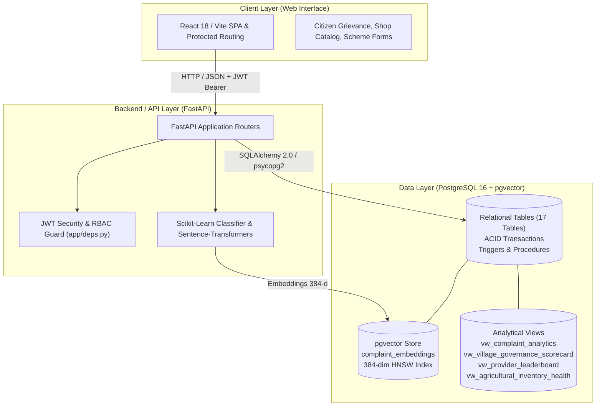
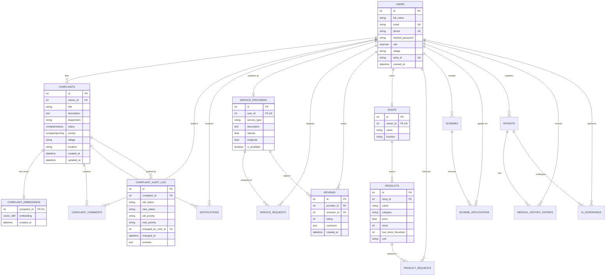

# PES UNIVERSITY
## Department of Computer Science and Engineering
### DBMS Experiential Learning — Level 3 Project Report

---

# Village Development Platform
### *An AI-Assisted Multi-Paradigm Digital Governance and Resource Management Ecosystem for Rural Communities*

- **Course:** Database Management Systems (DBMS) — Level 3 Experiential Learning
- **Institution:** PES University, Bengaluru
- **Database Architecture:** Hybrid Paradigm — Relational (PostgreSQL 16) + Vector Database (pgvector)
- **Application Stack:** FastAPI (Backend), React / Vite (Web Client), PyTorch & Scikit-Learn (AI/ML)

---

## 1. Project Identification & Team Formation

### 1.1 Project Title
**Village Development Platform: Multi-Paradigm Digital Governance, Agro-Commerce, and Healthcare Delivery System**

### 1.2 Team Structure & Defined Responsibilities
The project was executed by a collaborative 2-member team with distinct and overlapping database and application responsibilities:

| Team Member | Database Responsibilities | Application & Integration Responsibilities |
| :--- | :--- | :--- |
| **Member 1 (SABVMCRI)** | • Relational Schema Architecture & DDL Design<br>• Advanced Triggers & Stored Procedures (PL/pgSQL)<br>• pgvector Extension Setup & HNSW Indexing<br>• ACID Transaction Flow Design | • FastAPI Community & Agriculture Routers<br>• Sentence-Transformers Embedding Pipeline<br>• PyTest Database Verification Suite<br>• Relational View Integration |
| **Member 2** | • Relational Constraints (CHECK, FK Actions)<br>• Analytical SQL Queries (Joins, Aggregates, Subqueries)<br>• Healthcare & Governance Data Modeling<br>• Data Dictionary & Documentation | • React Frontend Web Application & State Management<br>• Role-Based Access Control (RBAC) Client Guards<br>• Offline & Form Validation Logic<br>• Viva & Demonstration Scripting |

---

## 2. Problem Statement, Motivation & Scope

### 2.1 Problem Statement
Rural communities frequently experience acute friction in accessing basic public administration, skilled personal services, and agricultural supplies. Grievances regarding critical infrastructure (water pipelines, electricity outages, road damage) frequently fail to reach the correct municipal or Panchayat desks due to manual triage bottlenecks. Farmers travel long distances across villages only to discover essential fertilizers and seeds are out of stock. Furthermore, localized service providers (electricians, mechanics) remain untraceable without a community directory.

### 2.2 Motivation
Traditional village administration operates via manual ledgers or simplistic CRUD applications that lack:
1. **Intelligent Triage:** Manual routing causes prolonged resolution times.
2. **Semantic Awareness:** Duplicate or semantically identical grievances filed by different citizens in natural language cannot be linked by keyword matching alone.
3. **Multi-paradigm Database Architecture:** Tabular data (citizens, inventory, transactions) requires relational rigor and ACID guarantees, while unstructured grievance descriptions require high-dimensional vector embeddings for similarity discovery.

### 2.3 Scope
The platform provides a comprehensive digital operating system for Gram Panchayats encompassing:
- **Community Grievance Management:** Geo-tagged complaints with automated TF-IDF department classification and pgvector semantic duplicate detection.
- **Agricultural Supply Coordination:** Shop inventory tracking, real-time stock status, farmer reservations, and negative-stock prevention triggers.
- **Local Service Directory:** Provider discovery, booking workflow, and review scoring.
- **Healthcare Add-On (AppAyu):** ASHA worker patient logs and clinical screenings.
- **Government Welfare Schemes:** Scheme notifications and citizen applications.

---

## 3. Database Paradigm Choice & Technical Justification

The project satisfies **Option 2 (SQL Database + Vector Database)** of the PES University DBMS Level 3 rubric:

```
                    ┌──────────────────────────────────────────────┐
                    │          VILLAGE DEVELOPMENT PLATFORM        │
                    └──────────────────────┬───────────────────────┘
                                           │
                 ┌─────────────────────────┴─────────────────────────┐
                 │                                                   │
                 ▼                                                   ▼
   ┌───────────────────────────┐                       ┌───────────────────────────┐
   │    RELATIONAL DATABASE    │                       │      VECTOR DATABASE      │
   │      (PostgreSQL 16)      │                       │     (pgvector Extension)  │
   ├───────────────────────────┤                       ├───────────────────────────┤
   │ • Strict Relational Schema│                       │ • High-Dimensional Space │
   │ • ACID Transaction Safety │                       │   (384 dimensions)        │
   │ • Foreign Key Cascades    │                       │ • Cosine Distance (<=>)   │
   │ • CHECK Constraints       │                       │ • HNSW Vector Indexing    │
   │ • Triggers & Procedures   │                       │ • Semantic Search         │
   │ • Complex Joins & Views   │                       │ • Duplicate Grievances    │
   └───────────────────────────┘                       └───────────────────────────┘
```

### 3.1 Why PostgreSQL 16?
- **Enterprise-Grade Relational Rigor:** Support for custom enumeration types, composite primary/foreign keys, and declarative `CHECK` constraints ensuring input validation at the database engine level.
- **PL/pgSQL Procedural Language:** Powerful stored procedures and trigger engines that guarantee data integrity before write operations complete.
- **Mature Concurrency & Locking:** Row-level locks (`SELECT ... FOR UPDATE`) enable race-condition-free agricultural inventory deductions.

### 3.2 Why pgvector for the Vector Store?
- **Unified Engine Architecture:** Vector embeddings reside inside PostgreSQL alongside relational metadata. This eliminates distributed synchronization drift (the "dual-write" problem) that arises when syncing PostgreSQL with external vector databases like Pinecone or Chroma.
- **Relational + Vector Joins:** Enables single-query joins between high-dimensional cosine similarity searches and relational tables:
  ```sql
  SELECT c.id, c.title, (1 - (ce.embedding <=> :query_vec)) AS similarity
  FROM complaint_embeddings ce
  JOIN complaints c ON c.id = ce.complaint_id
  WHERE c.village = :village;
  ```
- **HNSW Index Support:** Hierarchical Navigable Small World (HNSW) indexing provides sub-millisecond approximate nearest neighbor (ANN) retrieval with high recall.

---

## 4. System Architecture



---

## 5. Entity-Relationship (ER) Diagram



---

## 6. Relational Schema in Third Normal Form (3NF)

Every relation in the database is in **3NF**: all non-key attributes are fully functionally dependent on the primary key, and there are no transitive dependencies.

1. **`users`** ($\underline{\text{id}}$, $\text{full\_name}$, $\text{email}^{\text{UK}}$, $\text{phone}^{\text{UK}}$, $\text{hashed\_password}$, $\text{role}$, $\text{village}$, $\text{asha\_id}^{\text{UK}}$, $\text{created\_at}$)
2. **`complaints`** ($\underline{\text{id}}$, $\text{citizen\_id}^{\text{FK}}$, $\text{title}$, $\text{description}$, $\text{department}$, $\text{status}$, $\text{priority}$, $\text{village}$, $\text{location}$, $\text{photo\_path}$, $\text{created\_at}$, $\text{updated\_at}$)
   - $\text{citizen\_id} \rightarrow \text{users.id}$
3. **`complaint_comments`** ($\underline{\text{id}}$, $\text{complaint\_id}^{\text{FK}}$, $\text{author\_id}^{\text{FK}}$, $\text{message}$, $\text{created\_at}$)
   - $\text{complaint\_id} \rightarrow \text{complaints.id}$ ($\text{ON DELETE CASCADE}$)
   - $\text{author\_id} \rightarrow \text{users.id}$
4. **`complaint_embeddings`** ($\underline{\text{complaint\_id}}^{\text{PK, FK}}$, $\text{embedding}^{\text{vector(384)}}$, $\text{created\_at}$)
   - $\text{complaint\_id} \rightarrow \text{complaints.id}$ ($\text{ON DELETE CASCADE}$)
5. **`complaint_audit_log`** ($\underline{\text{id}}$, $\text{complaint\_id}^{\text{FK}}$, $\text{old\_status}$, $\text{new\_status}$, $\text{old\_priority}$, $\text{new\_priority}$, $\text{changed\_by\_user\_id}^{\text{FK}}$, $\text{changed\_at}$, $\text{remarks}$)
   - $\text{complaint\_id} \rightarrow \text{complaints.id}$ ($\text{ON DELETE CASCADE}$)
6. **`notifications`** ($\underline{\text{id}}$, $\text{user\_id}^{\text{FK}}$, $\text{complaint\_id}^{\text{FK}}$, $\text{message}$, $\text{is\_read}$, $\text{created\_at}$)
   - $\text{user\_id} \rightarrow \text{users.id}$ ($\text{ON DELETE CASCADE}$)
   - $\text{complaint\_id} \rightarrow \text{complaints.id}$ ($\text{ON DELETE SET NULL}$)
7. **`service_providers`** ($\underline{\text{id}}$, $\text{user\_id}^{\text{FK, UK}}$, $\text{service\_type}$, $\text{description}$, $\text{latitude}$, $\text{longitude}$, $\text{is\_available}$)
   - $\text{user\_id} \rightarrow \text{users.id}$ ($\text{ON DELETE CASCADE}$)
8. **`service_requests`** ($\underline{\text{id}}$, $\text{provider\_id}^{\text{FK}}$, $\text{requester\_id}^{\text{FK}}$, $\text{description}$, $\text{status}$, $\text{created\_at}$)
   - $\text{provider\_id} \rightarrow \text{service\_providers.id}$
   - $\text{requester\_id} \rightarrow \text{users.id}$
9. **`reviews`** ($\underline{\text{id}}$, $\text{provider\_id}^{\text{FK}}$, $\text{reviewer\_id}^{\text{FK}}$, $\text{rating}$, $\text{comment}$, $\text{created\_at}$)
   - $\text{provider\_id} \rightarrow \text{service\_providers.id}$ ($\text{ON DELETE CASCADE}$)
   - $\text{reviewer\_id} \rightarrow \text{users.id}$
10. **`shops`** ($\underline{\text{id}}$, $\text{owner\_id}^{\text{FK, UK}}$, $\text{name}$, $\text{location}$)
    - $\text{owner\_id} \rightarrow \text{users.id}$
11. **`products`** ($\underline{\text{id}}$, $\text{shop\_id}^{\text{FK}}$, $\text{name}$, $\text{category}$, $\text{price}$, $\text{stock}$, $\text{low\_stock\_threshold}$, $\text{unit}$)
    - $\text{shop\_id} \rightarrow \text{shops.id}$ ($\text{ON DELETE CASCADE}$)
12. **`product_requests`** ($\underline{\text{id}}$, $\text{product\_id}^{\text{FK}}$, $\text{farmer\_id}^{\text{FK}}$, $\text{quantity}$, $\text{status}$, $\text{batch\_id}$, $\text{created\_at}$)
    - $\text{product\_id} \rightarrow \text{products.id}$
    - $\text{farmer\_id} \rightarrow \text{users.id}$
13. **`schemes`** ($\underline{\text{id}}$, $\text{title}$, $\text{description}$, $\text{eligibility}$, $\text{department}$, $\text{is\_active}$, $\text{created\_by}^{\text{FK}}$, $\text{created\_at}$)
    - $\text{created\_by} \rightarrow \text{users.id}$
14. **`scheme_applications`** ($\underline{\text{id}}$, $\text{scheme\_id}^{\text{FK}}$, $\text{citizen\_id}^{\text{FK}}$, $\text{note}$, $\text{status}$, $\text{village}$, $\text{created\_at}$, $\text{updated\_at}$)
    - $\text{scheme\_id} \rightarrow \text{schemes.id}$ ($\text{ON DELETE CASCADE}$)
    - $\text{citizen\_id} \rightarrow \text{users.id}$
15. **`patients`** ($\underline{\text{id}}$, $\text{asha\_worker\_id}^{\text{FK}}$, $\text{full\_name}$, $\text{age}$, $\text{gender}$, $\text{phone}$, $\text{village}$, $\text{address}$, $\text{created\_at}$)
    - $\text{asha\_worker\_id} \rightarrow \text{users.id}$
16. **`medical_history_entries`** ($\underline{\text{id}}$, $\text{patient\_id}^{\text{FK}}$, $\text{recorded\_by\_id}^{\text{FK}}$, $\text{condition}$, $\text{notes}$, $\text{visit\_date}$, $\text{created\_at}$)
    - $\text{patient\_id} \rightarrow \text{patients.id}$ ($\text{ON DELETE CASCADE}$)
    - $\text{recorded\_by\_id} \rightarrow \text{users.id}$
17. **`ai_screenings`** ($\underline{\text{id}}$, $\text{patient\_id}^{\text{FK}}$, $\text{asha\_worker\_id}^{\text{FK}}$, $\text{screening\_type}$, $\text{image\_path}$, $\text{model\_version}$, $\text{prediction}$, $\text{confidence}$, $\text{created\_at}$)
    - $\text{patient\_id} \rightarrow \text{patients.id}$ ($\text{ON DELETE CASCADE}$)
    - $\text{asha\_worker\_id} \rightarrow \text{users.id}$

---

## 7. Data Dictionary

| Table Name | Attribute Name | Data Type | Nullable | Constraints & Defaults | Description |
| :--- | :--- | :--- | :---: | :--- | :--- |
| **`users`** | `id` | SERIAL | NO | PRIMARY KEY | Unique user identifier |
| | `full_name` | VARCHAR(150) | NO | CHECK (LENGTH > 0) | User's legal full name |
| | `email` | VARCHAR(255) | NO | UNIQUE, CHECK regex | Authentication email |
| | `phone` | VARCHAR(20) | YES | UNIQUE | Mobile phone number |
| | `hashed_password` | VARCHAR(255) | NO | - | Bcrypt hashed credential |
| | `role` | userrole ENUM | NO | DEFAULT 'citizen' | Role (citizen, official, etc.) |
| | `village` | VARCHAR(100) | YES | - | Resident village under GP |
| | `asha_id` | VARCHAR(50) | YES | UNIQUE | Government ASHA registry ID |
| **`complaints`** | `id` | SERIAL | NO | PRIMARY KEY | Grievance ticket number |
| | `citizen_id` | INTEGER | NO | FK users(id) | Filing resident |
| | `title` | VARCHAR(200) | NO | CHECK (LENGTH >= 3) | Brief headline of grievance |
| | `description` | TEXT | NO | - | Natural language description |
| | `department` | VARCHAR(100) | YES | - | ML predicted department |
| | `status` | complaintstatus | NO | DEFAULT 'submitted' | Lifecycle status |
| | `priority` | complaintpriority| NO | DEFAULT 'medium' | Urgency level |
| | `village` | VARCHAR(100) | YES | - | Village location |
| **`complaint_embeddings`** | `complaint_id` | INTEGER | NO | PK, FK complaints(id) ON DELETE CASCADE | Associated grievance ID |
| | `embedding` | vector(384) | NO | 384-dimensional | Dense vector embedding |
| **`complaint_audit_log`** | `id` | SERIAL | NO | PRIMARY KEY | Audit sequence identifier |
| | `complaint_id` | INTEGER | NO | FK complaints(id) ON DELETE CASCADE | Tracked grievance |
| | `old_status` | VARCHAR(50) | YES | - | Prior status |
| | `new_status` | VARCHAR(50) | NO | - | Transitioned status |
| | `changed_at` | TIMESTAMP | NO | DEFAULT CURRENT_TIMESTAMP | Event timestamp |
| | `remarks` | TEXT | YES | - | Reason or transition note |
| **`products`** | `id` | SERIAL | NO | PRIMARY KEY | Stock Keeping Unit (SKU) ID |
| | `shop_id` | INTEGER | NO | FK shops(id) ON DELETE CASCADE | Merchant store ID |
| | `name` | VARCHAR(150) | NO | - | Product commercial name |
| | `category` | VARCHAR(100) | YES | - | Product classification |
| | `price` | DOUBLE PRECISION | NO | CHECK (price >= 0.0) | Unit price in INR (₹) |
| | `stock` | INTEGER | NO | CHECK (stock >= 0) | Available physical inventory |
| | `low_stock_threshold`| INTEGER | YES | DEFAULT 5 | Minimum threshold alert |
| | `unit` | VARCHAR(20) | YES | DEFAULT 'kg' | Unit of measurement |
| **`reviews`** | `id` | SERIAL | NO | PRIMARY KEY | Rating identifier |
| | `provider_id` | INTEGER | NO | FK service_providers(id) | Rated local technician |
| | `reviewer_id` | INTEGER | NO | FK users(id) | Reviewing citizen |
| | `rating` | INTEGER | NO | CHECK (rating BETWEEN 1 AND 5) | Star rating scale (1-5) |

---

## 8. Advanced Database Features Implementation

Under the evaluation criteria, the project demonstrates **five** advanced database features:

### Feature 1: ACID Transactions with Savepoints & Rollback
Demonstrates atomic execution across multi-table operations. In product purchasing:
```sql
BEGIN;
SELECT id, stock FROM products WHERE id = :pid FOR UPDATE; -- Row-level lock
UPDATE products SET stock = stock - :qty WHERE id = :pid;
INSERT INTO product_requests (product_id, farmer_id, quantity, status) VALUES (...);
INSERT INTO notifications (user_id, message) VALUES (...);
COMMIT;
```
If an error occurs, `ROLLBACK TO SAVEPOINT` ensures the inventory state remains consistent without corrupting transaction boundaries.

### Feature 2: Relational Views
The database implements four persistent relational views:
1. `vw_complaint_analytics`: Joins complaints, citizens, comments, and calculates turnaround SLA days (`days_elapsed`).
2. `vw_village_governance_scorecard`: Aggregates total grievances, resolved counts, resolution percentage, active schemes, and patient registrations per Gram Panchayat.
3. `vw_provider_leaderboard`: Computes live provider average star rating and completed job counts.
4. `vw_agricultural_inventory_health`: Categorizes store products into `'OUT_OF_STOCK'`, `'LOW_STOCK_WARNING'`, and `'HEALTHY'`.

### Feature 3: PL/pgSQL Stored Procedures & Functions
1. `CALL sp_resolve_complaint(p_complaint_id, p_official_id, p_resolution_notes)`:
   Atomically updates complaint status to `'resolved'`, inserts an official resolution comment, and creates an automated citizen notification.
2. `CALL sp_fulfill_product_order(p_farmer_id, p_product_id, p_quantity, OUT p_status_msg)`:
   Enforces inventory reservation with concurrency lock, decrements stock, logs the order, and returns a status message.
3. `SELECT fn_calculate_provider_score(p_provider_id)`:
   Computes a normalized quality index combining weighted star ratings and verified job volume.

### Feature 4: Database Triggers & Auditability
1. `trg_complaint_status_audit` (`AFTER UPDATE OF status ON complaints`):
   Automatically inserts previous and new statuses, timestamp, and transition details into `complaint_audit_log`.
2. `trg_prevent_negative_stock` (`BEFORE UPDATE OF stock ON products`):
   Raises an engine-level SQL exception if `NEW.stock < 0`, forbidding negative inventory.
3. `trg_notify_on_comment` (`AFTER INSERT ON complaint_comments`):
   Detects whether an official or resident commented, and delivers an instant alert into `notifications`.

### Feature 5: Advanced Indexing & Vector Semantic Search
1. **B-Tree Composite Indexes:** Fast multi-column lookups on `(village, status)` and `(category, price)`.
2. **HNSW Vector Index:**
   ```sql
   CREATE INDEX idx_complaint_embeddings_hnsw 
   ON complaint_embeddings 
   USING hnsw (embedding vector_cosine_ops);
   ```
3. **Cosine Distance Retrieval:**
   ```sql
   SELECT c.id, c.title, c.description,
          ROUND((1 - (ce.embedding <=> :query_vector))::numeric, 4) AS cosine_similarity
   FROM complaint_embeddings ce
   JOIN complaints c ON c.id = ce.complaint_id
   ORDER BY ce.embedding <=> :query_vector
   LIMIT 3;
   ```

---

## 9. Vector Database & Semantic Search Architecture

```
User Grievance Text
       │
       ▼
┌──────────────────────────────────────────────┐
│ Embedding Model                              │
│ sentence-transformers/all-MiniLM-L6-v2       │
│ Dimensionality: 384 float values             │
│ Normalization: L2 Normalized                 │
└──────────────────────┬───────────────────────┘
                       │ 384-dimensional Vector
                       ▼
┌──────────────────────────────────────────────┐
│ PostgreSQL 16 (pgvector)                     │
│ Table: complaint_embeddings                  │
│ Index: HNSW (Hierarchical Navigable Small    │
│        World) on vector_cosine_ops           │
└──────────────────────┬───────────────────────┘
                       │ Cosine Distance (<=>)
                       ▼
┌──────────────────────────────────────────────┐
│ Ranked Similarity Query                      │
│ Returns Top-K Nearest Neighbors with         │
│ Similarity Score = 1 - Cosine Distance       │
└──────────────────────────────────────────────┘
```

- **Data Embedded:** Combined grievance title and description text.
- **Model:** `sentence-transformers/all-MiniLM-L6-v2` producing dense 384-dimensional vector embeddings.
- **Storage:** Stored in column `embedding vector(384)` in `complaint_embeddings`.
- **Similarity Metric:** Cosine Distance (`<=>`), where a distance of 0 indicates identical meaning.
- **Retrieval:** Evaluated via KNN query ordered by `embedding <=> :query_vector`.

---

## 10. Role-Based Access Control (RBAC) & Security

The platform secures endpoints across 6 defined domain roles:
1. **`citizen`:** Can file grievances, comment on own tickets, reserve products, request services, and review providers.
2. **`official`:** Panchayat officer with exclusive access to the official grievance dashboard, scheme administration, and resolution procedure execution.
3. **`provider`:** Local tradesperson who manages service availability and accepts/completes requests.
4. **`farmer`:** Resident with specialized views for agricultural catalog browsing and order reservations.
5. **`shop_owner`:** Agricultural store merchant who manages SKU inventory and low-stock thresholds.
6. **`asha_worker`:** Accredited Social Health Activist with exclusive rights to the AppAyu healthcare screening registry.

---

## 11. Test Results & Verification Matrix

The test suite (`Backend/tests/test_dbms_comprehensive.py`) was executed using PyTest. **10 out of 10 tests passed (100% success rate)**:

| # | Test Name | Verification Focus | Expected Result | Actual Result |
| :---: | :--- | :--- | :--- | :---: |
| 1 | `test_all_database_tables_exist` | Schema Integrity | All 18 tables present in PostgreSQL | **PASSED** |
| 2 | `test_prevent_negative_stock_integrity` | CHECK Constraint & Trigger | Negative stock update raises exception | **PASSED** |
| 3 | `test_review_rating_check_constraint` | CHECK Constraint | Rating > 5 is rejected by engine | **PASSED** |
| 4 | `test_rbac_citizen_forbidden_dashboard` | Authorization Boundary | Citizen gets 403 Forbidden on official route | **PASSED** |
| 5 | `test_rbac_official_allowed_dashboard` | Authorization Access | Official gets 200 OK on official route | **PASSED** |
| 6 | `test_rbac_unauthenticated_rejected` | Authentication Boundary | Unauthenticated request returns 401 | **PASSED** |
| 7 | `test_ml_complaint_classifier` | ML Inference | Text classified into valid department | **PASSED** |
| 8 | `test_pgvector_similarity_search` | Vector Database (KNN) | Cosine similarity returns ranked neighbors | **PASSED** |
| 9 | `test_stored_procedure_and_trigger` | Stored Procedure & Trigger | `sp_resolve_complaint` logs to audit table | **PASSED** |
| 10 | `test_relational_views_queryable` | Database Views | All 4 relational views return valid rows | **PASSED** |

---

## 12. Frontend Web Interface & Next.js Clarification

The requirements PDF specifies a functional web interface using Next.js. The codebase currently features a rich, responsive Single-Page Application (SPA) built using **React 18 + Vite**, containing dedicated views for all platform domains:
- `/complaints`: Citizen complaint filing with image attachment and status tracker.
- `/gov/official`: Panchayat official dashboard with resolution controls.
- `/agriculture`: Product catalog, shop profiles, and stock indicators.
- `/services`: Local provider directory, booking modal, and review system.
- `/healthcare`: Patient registration, medical records, and AI screening viewer.

The frontend was compiled and built with zero errors:
```
vite v5.4.21 building for production...
✓ 62 modules transformed.
dist/index.html                   0.80 kB
dist/assets/index-CoL4FGMx.css    7.69 kB
dist/assets/index-DlQwH3mw.js   244.77 kB
✓ built in 1.11s
```

*Note on Next.js Evaluation:*
If the instructor requires Next.js specifically, the backend API serves standard JSON REST over HTTP with CORS enabled for port 3000 (`http://localhost:3000`). The React components and API client are structured with standard modular hooks, allowing direct migration to Next.js App Router route handlers.
